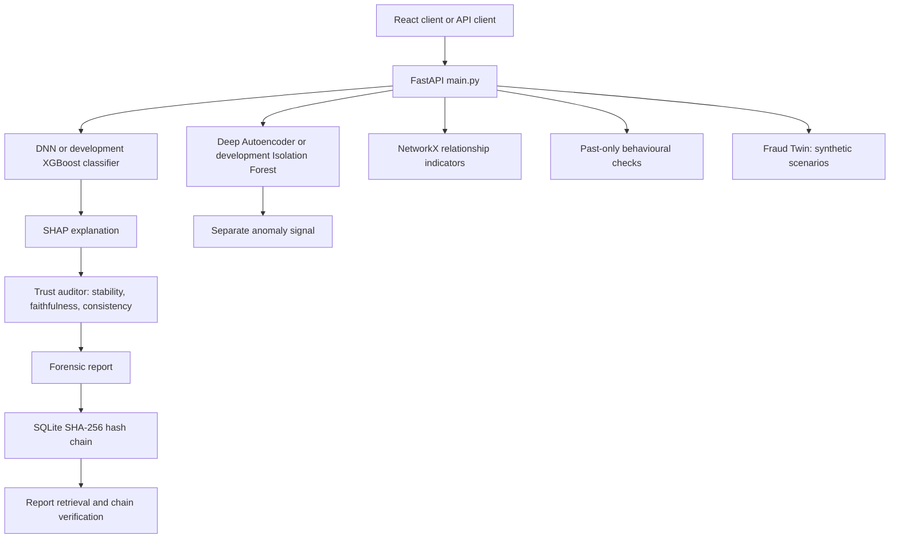

# FinGuard Backend

A local, synthetic-data hackathon backend demonstrating fraud scoring, graph and behaviour
indicators, Fraud Twin scenarios, SHAP explanations, bounded trust audits, and a SHA-256
chained SQLite audit log.

> **Important:** This is a demonstration prototype using synthetic data. It is not a
> production payment-fraud system, does not establish regulatory compliance, and its
> hash chain is tamper-evident rather than physically immutable. Protect the database
> file and backups; a privileged attacker who can rewrite the entire database can rebuild
> the chain.

## Architecture



## Threat model

- **Protected asset:** integrity and usefulness of the explanation presented to an analyst.
- **Attacker capability:** alter transaction-level manipulable fields (`amount`,
  `timestamp_hour`, `mcc_code`, `merchant_id`) while historical fields remain fixed.
- **Threat:** explanation instability or proxy-feature emphasis that hides meaningful
  risk drivers.
- **Controls demonstrated:** bounded perturbations, top-3 set comparison, feature
  ablation, narrative withholding on unstable explanations, forensic reporting, and
  hash-chained audit records.
- **Attack demo detail:** `/api/v1/demo/simulate-attack` explicitly injects a proxy-only
  explanation payload for the poisoned example while leaving the fraud model inputs
  unchanged. Bounded MCC changes remove that injected mask, so the audit can show
  narrative withholding and hidden-driver discovery. This is a controlled test fixture;
  it does not claim that Tree SHAP naturally produces the forged attribution.
- **Out of scope:** user identity and role-based authorization, real payment integrations, production model
  monitoring, external key management, and a genuinely immutable/WORM ledger.

## Folder structure

```text
finguard_backend/
|-- main.py                         FastAPI routes and Pydantic schemas
|-- engine/
|   |-- assessment.py               Unified intelligence assessment pipeline
|   |-- behaviour_intelligence.py   Past-only account behaviour checks
|   |-- graph_intelligence.py       NetworkX relationship indicators
|   |-- fraud_twin.py               Controlled synthetic attack scenarios
|   |-- verdict.py                  Explanation trust audit
|   |-- ledger.py                   SQLite SHA-256 audit chain
|   |-- torch_model.py              DNN, autoencoder, and model bundle
|   |-- benchmark_intelligence.py   Reproducible local microbenchmark
|   |-- test_*.py                   Unit and integration checks
|-- data/ and artifacts/             Synthetic development data and models
|-- requirements.txt
|-- README.md
```
## Run locally (Python 3.11+)

### Windows PowerShell

```powershell
py -3.11 -m venv .venv
.venv\Scripts\Activate.ps1
python -m pip install --upgrade pip
pip install -r requirements.txt
python -m engine.test_perturb
python -m engine.test_verdict
python -m engine.test_fraud_twin
python -m engine.test_intelligence
python -m engine.test_intelligence_api
python -m engine.test_hardening
uvicorn main:app --reload
```

### Ubuntu / WSL

```bash
python3.11 -m venv .venv
source .venv/bin/activate
python -m pip install --upgrade pip
pip install -r requirements.txt
python -m engine.test_perturb
python -m engine.test_verdict
python -m engine.test_fraud_twin
python -m engine.test_intelligence
python -m engine.test_intelligence_api
python -m engine.test_hardening
uvicorn main:app --reload
```

Open API docs at `http://127.0.0.1:8000/docs`.

### Optional Docker run

`Dockerfile` and `.dockerignore` provide a single-container development setup.
Build and run only if Docker Desktop is installed:

```powershell
docker volume create finguard-data
docker build -t finguard-backend .
docker run --rm -p 8000:8000 `
  -e FINGUARD_DB_PATH=/data/finguard.db `
  --mount source=finguard-data,target=/data `
  finguard-backend
```

The persistent volume stores SQLite data across container restarts. This container
uses development mode and is not a production deployment configuration.

### One-command synthetic demo (PowerShell)

After installing requirements, run `powershell -NoProfile -ExecutionPolicy Bypass -File .\start_demo.ps1`.
The bypass applies to that process only and does not change Windows policy. The script creates three separate
synthetic datasets and PyTorch model bundles, configures the v1, v2, and frontend scan models, and starts
Uvicorn on localhost. Use `-Rows 6000 -FraudRate 0.05 -Epochs 12` to override defaults.
Generated files are placed in timestamped folders ignored by Git. The scores are for
demo plumbing only, not real payment decisions.

In local development, set `FINGUARD_API_KEY` if you want the audit, demo, and ledger
routes to require an `X-API-Key` header. `FINGUARD_DB_PATH` can select a different local
SQLite file. Both are optional in development.

## Demo request

```bash
curl -X POST http://127.0.0.1:8000/api/v1/demo/simulate-attack
```

## Fraud Twin synthetic attack simulation

`POST /api/v1/fraud-twin/simulate` is a local defensive test endpoint. It creates
its own synthetic suspicious transaction; the request cannot submit an arbitrary
transaction or contact a bank. It is disabled when `FINGUARD_ENV=production`.
If `FINGUARD_API_KEY` is set, provide the key in the `X-API-Key` header.

Example JSON body:

```json
{
  "seed": 42,
  "split_parts": 4
}
```

The response contains four scenarios: transaction splitting, behaviour mimicry,
velocity manipulation, and coordinated synthetic accounts. Each report preserves
the original values, lists changed model features and context fields, and gives
the loaded fraud model probability and autoencoder/anomaly output for original
and changed transactions. A scenario is marked as an evasion only when the
original was detected and every modified transaction falls below both configured
detection checks; coordinated-account scenarios also use the graph indicators.
The fraud probability threshold is 0.50; anomaly detection uses the loaded model's
score threshold of zero. These are demo settings, not validated operational thresholds.

Run it in PowerShell after starting the demo server:

```powershell
$body = '{"seed":42,"split_parts":4}'
Invoke-RestMethod -Method Post `
  -Uri http://127.0.0.1:8000/api/v1/fraud-twin/simulate `
  -ContentType 'application/json' -Body $body
```

The current v1 row model has hour-level timestamps and no account graph input.
The coordinated-account scenario is therefore also checked by the new NetworkX
indicator module; the row classifier alone cannot see account relationships.
The generated scenarios and model outcomes are suitable for the synthetic demo;
they do not demonstrate that a real fraud attack would succeed.

## FinGuard 2.0 relationship, behaviour, and unified assessment APIs

| Endpoint | Purpose |
|---|---|
| `POST /api/v1/intelligence/graph` | Analyse a transfer batch for relationship indicators. |
| `POST /api/v1/intelligence/behaviour` | Compare a current transfer with earlier records for one account. |
| `POST /api/v1/intelligence/assess` | Return fraud probability, anomaly, graph, behaviour, explanation, trust, forensic report, and audit hash. |
| `GET /api/v1/forensic/{txn_id}` | Retrieve the latest full report saved for a transaction. |
| `GET /api/v1/ledger` | List recent ledger entries and verify the chain. |

The complete assessment request has `transaction` (the existing 14-field v1
model payload), `account_id`, `beneficiary_account_id`, timezone-aware
`occurred_at`, and optional `history` records. Its model `timestamp_hour` must
match `occurred_at`. The response deliberately keeps the classifier probability,
autoencoder anomaly score, graph indicators, behavioural indicators, and trust
verdict separate. There is no arbitrary weighted “overall fraud score.” A low
trust verdict concerns the explanation; it does not mean the transaction is safe
or fraudulent. The full assessment runs explanation auditing synchronously and
can take longer than prediction-only scans.

Graph thresholds are explicit indicators, not labels: repeated directed pairs
(3 transfers in 24 hours), circular paths up to 4 accounts, 3 or more senders to
one receiver, connected clusters of at least 3 nodes with density at least 0.70,
onward movement within 60 minutes with no more than a 5% amount increase, and
accounts with at least 5 distinct counterparties. Cycle traversal, rapid-pair
checks, result counts, and references have caps; `analysis_truncated` reports
when any cap affects coverage. Raw account IDs are not returned. Output account
references use HMAC pseudonyms; without `FINGUARD_GRAPH_PSEUDONYM_KEY`, the key
is generated per process and references rotate after a restart.

Behaviour analysis uses only same-account history from the preceding 30 days
that is strictly earlier than the transaction being assessed. At least 5 prior
rows are needed before it emits indicators. It checks robust amount deviation,
recent frequency, short time gaps, unseen hours (with at least 10 rows), new
recipients, and daily-volume changes (with at least 5 observed days). Future and
same-time rows are ignored. The request has no device, IP, biometric, or location
fields, so those are not inferred. With insufficient history, the response says
so and emits no behavioural flags.

Frontend/API clients can call these paths with `fetch` or `Invoke-RestMethod`;
FastAPI schemas and examples are available at `http://127.0.0.1:8000/docs` in
development. If `FINGUARD_API_KEY` is configured, send it in `X-API-Key`.
Forensic reports are retained in the existing local SQLite ledger. The ledger is
tamper-evident, not independently anchored or immutable.

## Performance baseline and reproduction

Run a local synthetic microbenchmark with:

```powershell
.\.venv\Scripts\python.exe -m engine.benchmark_intelligence --iterations 5 --graph-rows 100
```

The benchmark warms each function once, then reports median, mean, p95 and
sequential throughput. It also reports process working-set memory before and
after the run. This is not a concurrent load test, and the numbers are not a
production capacity claim.

Observed on Python 3.11.9, Windows 10, Intel64 Family 6 Model 186, using the
default synthetic in-memory XGBoost + Isolation Forest fallback. Graph used 100
synthetic transfer rows; behaviour used 60 prior rows. Trust and full assessment
used three timed runs, so treat the tails as rough local evidence.

| Operation | Median | p95 | Sequential throughput |
|---|---:|---:|---:|
| Fraud prediction | 4.165 ms | 5.127 ms | 227.83/s |
| Anomaly detection | 21.282 ms | 21.471 ms | 48.50/s |
| SHAP explanation (reused prediction, no anomaly call) | 7.512 ms | 9.233 ms | 124.79/s |
| Trust audit, prior repeated-inference path | 249.339 ms | 249.414 ms | 4.14/s |
| Trust audit, reused baseline / explanation-only perturbations | 119.697 ms | 149.900 ms | 8.12/s |
| Fraud Twin, four scenarios including graph checks | 602.223 ms | 620.563 ms | 1.67/s |
| Graph analysis, 100 transfers | 9.139 ms | 11.092 ms | 103.71/s |
| Behaviour analysis, 60 history rows | 0.657 ms | 0.830 ms | 1443.29/s |
| Full assessment computation, excluding HTTP and ledger | 118.540 ms | 137.806 ms | 8.28/s |
| Full assessment plus SQLite append | 165.554 ms | 279.235 ms | 5.13/s |

The trust-audit optimization avoids recalculating the baseline fraud score and
autoencoder output during explanation-only perturbations. In this same-process
microbenchmark, median trust-audit time fell about 52% (249.339 to 119.697 ms).
Process RSS was 198.28 MB before the measured operations and 198.41 MB after.
These results depend on the installed model path, Python packages, CPU, and
synthetic input; rerun the command after changing any of them. `start_demo.ps1`
uses PyTorch bundles, so its performance will differ from these fallback-model
measurements.

The current API handles expensive explanation/trust work synchronously. For a
hackathon backend this keeps the setup small; it is not suitable for high
concurrency. Add a job queue only after measured request volume justifies it.

PowerShell examples:

```powershell
$graph = @{ transfers = @(
  @{ txn_id = 't1'; account_id = 'acct-a'; beneficiary_account_id = 'acct-b'; amount = 100; occurred_at = '2026-10-20T10:00:00Z' },
  @{ txn_id = 't2'; account_id = 'acct-b'; beneficiary_account_id = 'acct-c'; amount = 90; occurred_at = '2026-10-20T10:05:00Z' }
)} | ConvertTo-Json -Depth 8
Invoke-RestMethod -Method Post -Uri http://127.0.0.1:8000/api/v1/intelligence/graph -ContentType 'application/json' -Body $graph

# Submit a full assessment. These are synthetic example values.
$assessment = @{
  transaction = @{
    txn_id = 'demo-1001'; amount = 1250; timestamp_hour = 10; mcc_code = 5411
    merchant_id = 101; account_age_days = 900; device_fingerprint_age = 500
    historical_txn_count_30d = 12; card_age_days = 850; is_new_device = 0
    foreign_location_mismatch = 0; velocity_1h = 1
    risky_beneficiary_score = 0.1; is_recurring_subscription_window = 0
    merchant_category_loyalty = 0.9
  }
  account_id = 'synthetic-user'; beneficiary_account_id = 'synthetic-shop'
  occurred_at = '2026-10-20T10:00:00Z'; history = @()
} | ConvertTo-Json -Depth 10
Invoke-RestMethod -Method Post -Uri http://127.0.0.1:8000/api/v1/intelligence/assess -ContentType 'application/json' -Body $assessment
```

Health check:

```bash
curl http://127.0.0.1:8000/health
```

Ledger:

```bash
curl http://127.0.0.1:8000/api/v1/ledger
```

## Individual audit request

Send JSON with all feature fields to `POST /api/v1/audit/verify`.
The `enable_counterfactual=true` query parameter enables the bounded counterfactual hook.

## React frontend transaction scan

The React working copy at `FinGuard-AI-main-wired/frontend` sends imported transactions
to `POST /api/v1/transactions/scan`; the supplied original ZIP remains unchanged. The
route accepts the normalized records produced by `normalizeTransaction()`. Development
CORS allows Vite at `http://localhost:5173` and
`http://127.0.0.1:5173`.

Send the imported records as a batch:

```json
{
  "transactions": [
    {
      "id": "txn-1",
      "date": "2026-11-02T02:15:00+05:30",
      "description": "Bank transfer",
      "amount": 25000,
      "direction": "debit",
      "category": "Transfer",
      "method": "UPI",
      "receiver": "merchant@example",
      "status": "complete"
    }
  ]
}
```

The response includes `transactions_analyzed`, `total_amount`, `flagged_count`, and
`alerts` containing normalized transaction fields plus `reasons`. With
`FINGUARD_FRONTEND_MODEL_DIR` configured, the backend also scores every imported row
using a DNN and legitimate-only autoencoder trained for the frontend's available fields
(amount, time, direction, category, and method) plus deterministically simulated account/device
history. Flagged rows include SHAP signals and
bounded perturbation/ablation trust checks. High-value and overnight rules remain as
additional review signals. The one-command demo trains this model with synthetic labels;
its scores are not validated fraud probabilities. Simulated account/device values are
for exercising the model only. The PDF PCA bundle remains a separate schema and is not
applied to bank CSV rows. Without this bundle, the endpoint falls back to rule-based
review. Date-only records have no known transaction hour.

The model-based `/api/v1/audit/verify` route is separate because the imported bank rows
do not contain the historical, device, MCC, or other fields required by the model.

## PyTorch migration and PDF dataset (v2)

The existing `/api/v1/audit/verify` request and response contracts remain unchanged.
The PyTorch bundle supports that 14-field schema, and `/api/v2/audit/verify` is a
separate route for the PDF's Kaggle-style schema (`Time`, `V1` through `V28`,
`Amount`; label `Class` during training). The v2 route returns the same audit response
contract and appends the result to the same ledger. It is unavailable until a v2 model
bundle is configured.

The PDF is a notebook write-up, not the actual transaction CSV. The two feature sets
cannot be meaningfully concatenated: the PDF's PCA fields have no mapping to FinGuard's
named fields. For plumbing and dashboard development, generate a separate synthetic CSV
and PyTorch bundle for each API schema:

```powershell
python -m engine.simulate_finguard_data --output data\synthetic_finguard_v1.csv
python -m engine.train_torch `
  --data-file data\synthetic_finguard_v1.csv `
  --preset finguard-v1 `
  --label-column is_fraud `
  --data-classification synthetic `
  --output-dir artifacts\synthetic-finguard-v1

python -m engine.simulate_creditcard_data --output data\synthetic_creditcard.csv
python -m engine.train_torch `
  --data-file data\synthetic_creditcard.csv `
  --preset creditcard-kaggle `
  --label-column Class `
  --data-classification synthetic `
  --output-dir artifacts\synthetic-creditcard-demo
$env:FINGUARD_MODEL_DIR = (Resolve-Path artifacts\synthetic-finguard-v1).Path
$env:FINGUARD_CREDITCARD_MODEL_DIR = (Resolve-Path artifacts\synthetic-creditcard-demo).Path
uvicorn main:app --host 127.0.0.1 --port 8000
```

Both generated datasets have intentionally learnable patterns to exercise the DNN,
autoencoder, SHAP and trust-audit flows. Their metrics are not evidence of real fraud
accuracy. The two CSV files and bundles are ignored by Git. The v1 route keeps its
original request and response contract; v2 accepts only the PDF dataset's 30 features.

Once the approved `creditcard.csv` is available locally, train a separate bundle:

```powershell
python -m engine.train_torch `
  --data-file C:\path\to\creditcard.csv `
  --preset creditcard-kaggle `
  --label-column Class `
  --output-dir artifacts\creditcard-v1
```

Then configure the API before starting it:

```powershell
$env:FINGUARD_CREDITCARD_MODEL_DIR = (Resolve-Path artifacts\creditcard-v1).Path
uvicorn main:app --host 127.0.0.1 --port 8000
```

For an approved CSV matching the original 14 fields, use `--preset finguard-v1` (the
default) and set `FINGUARD_MODEL_DIR` to the output bundle. The API rejects a custom
or PCA model in the v1 slot and rejects a mismatched model in the v2 slot.

Both schemas use a PyTorch DNN for fraud probability and an autoencoder trained only
on legitimate rows for anomaly scoring. The bundle contains preprocessing metadata,
calibration, a SHAP reference, and checksums for model/background artifacts. The v2
audit perturbs `Amount` by ±5% and `Time` by up to 300 seconds while holding the PCA
components fixed; it compares top-three explanation sets, measures ablation faithfulness,
and compares explanation profiles to the training fraud reference. `V1`–`V28` are
anonymized PCA components, so no business meaning is inferred for them. Counterfactuals
are statistical what-if outputs, not recommended payment actions.

Training outputs validation metrics for the chosen split; they do not establish
production suitability. Review temporal leakage, calibration, subgroup performance,
false-positive costs, and drift with the dataset owner before deployment.

## Production readiness

The API has basic hardening for local integration: strict request fields and ranges,
an optional `X-API-Key` check configured with `FINGUARD_API_KEY`, request body size
limits, safe validation and server errors, response models, and stronger SQLite chain
verification. The ledger serializes writers and checks its stored summary columns
against the hashed payload. These controls do not make the service production-ready.

Production startup has a configuration gate. It requires a 32-character API key, a
32-character model signing key, signed v1 and frontend-scan model bundles tagged `approved` with an
approval reference, an absolute database path outside the application directory, and
`FINGUARD_SINGLE_NODE_SQLITE=1`. The demo attack and Fraud Twin routes are disabled in production. A
configured v2 bundle must also be signed and tagged approved. Model bundle signatures
cover the preprocessing metadata and artifact checksums; changing the bundle invalidates
the HMAC.

The frontend scan still refuses production because the browser does not provide verified
device/account context; its current history enrichment is synthetic. Replace those fields
with consented, verified inputs before enabling live scoring.

These settings do not turn synthetic data into validated fraud data. No approved
transaction CSV or model has been supplied to this workspace, so FinGuard still cannot
be started in production here. SQLite is limited to a single instance with persistent
mounted storage, and the hash chain has no independent WORM/external anchor. This setup
is not sufficient for regulated or high-volume payment decisions; use a managed database,
external audit anchoring, deployment TLS/rate limits, and an organization-approved
model-governance process for those environments.

When approved training data and an approval reference are available, set
`FINGUARD_MODEL_SIGNING_KEY` in the offline training environment and create the signed
bundle with `--data-classification approved --approval-reference <ticket>`. At runtime,
provide the same signing key through the deployment secret manager, along with:

```powershell
$env:FINGUARD_ENV = "production"
$env:FINGUARD_API_KEY = "<at-least-32-character-secret>"
$env:FINGUARD_MODEL_SIGNING_KEY = "<at-least-32-character-secret>"
$env:FINGUARD_MODEL_DIR = "<path-to-signed-v1-bundle>"
$env:FINGUARD_DB_PATH = "<absolute-path-on-persistent-volume>"
$env:FINGUARD_SINGLE_NODE_SQLITE = "1"
uvicorn main:app --host 0.0.0.0 --port 8000 --workers 1
```

Before production deployment, the team still needs to:

1. Provide approved, representative, labeled transaction data and define the fraud
   target, evaluation windows, acceptable false-positive rate, and rollout criteria.
2. Train and validate a versioned model artifact and preprocessing bundle, then review
   calibration, subgroup performance, drift, and explanation quality with domain owners.
3. Select the deployment platform and durable database, and set up migrations, backups,
   restore drills, monitoring, and alerting.
4. Select per-client identity and authorization, secret rotation through a secret
   manager, TLS termination, and shared rate limits at the API gateway or load balancer.
5. Define data minimization, retention/deletion, incident response, access logging, and
   independent audit anchoring requirements with security and compliance reviewers.

The demo attack deliberately injects a proxy-only explanation payload; this exercises
FinGuard's quarantine and forensic path but is not evidence that Tree SHAP naturally
fails on a real adversarial transaction.

## Scaling path after the hackathon

Keep this as one FastAPI application for the prototype. If multiple instances or
write volume require it, migrate the ledger behind a repository interface to
PostgreSQL, add schema migrations and restore tests, then move expensive full trust
audits to a small job queue that returns a job ID. Run multiple API workers only
after shared database storage, model loading, request idempotency, and rate limits
are verified. The Dockerfile is a single-instance development container, not a
cloud deployment recipe. Use managed secrets, TLS, external log/audit anchoring,
and a hosted database before exposing sensitive data. NetworkX is appropriate for
small supplied batches; profile representative graph sizes before considering a
graph database or specialized graph algorithms. Do not add a GNN without labelled
relationship data and an experiment showing it beats these interpretable rules.

## GitHub

```bash
git init
git add .
git commit -m "Build FinGuard backend"
git branch -M main
git remote add origin https://github.com/<YOUR-USERNAME>/<YOUR-REPOSITORY>.git
git push -u origin main
```

If the repository already has a remote, do not run `git remote add origin` again;
check it first with `git remote -v`.
